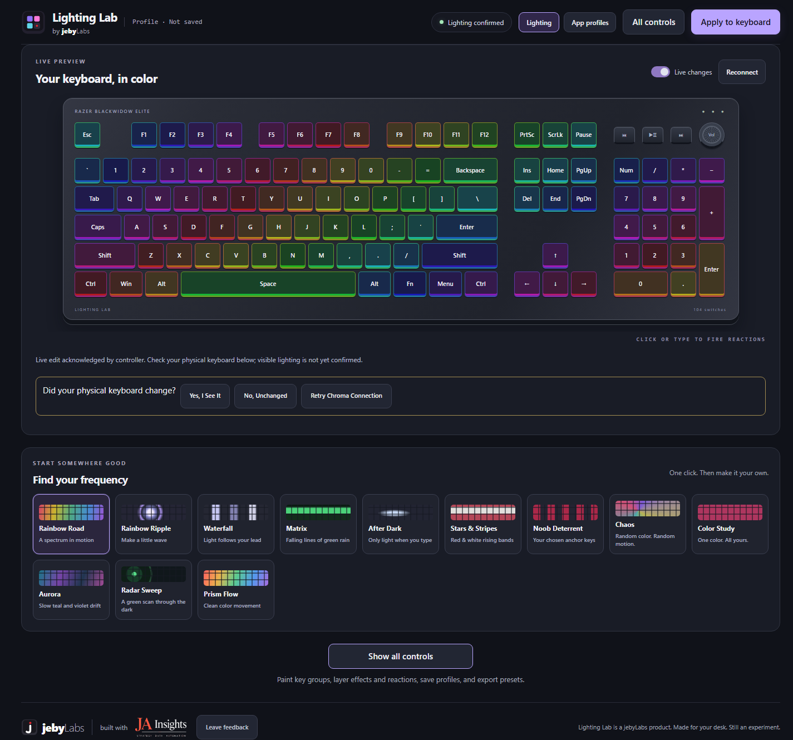
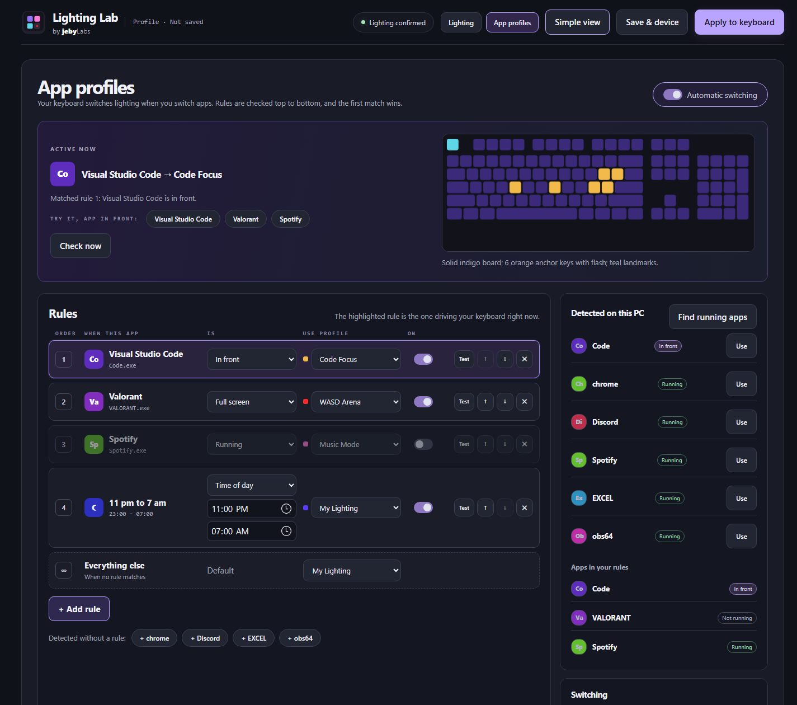

# Lighting Lab

**Make your keyboard look exactly how you want, in about two minutes.**
Lighting Lab finds your keyboard, shows it on screen key-for-key, and lets you paint it with live effects:
rainbows, Matrix rain, ripples that spread out from every key you press, keys that glow only when you type.
With a Razer keyboard connected, every click shows up on the real keys instantly. It can even switch looks
automatically when you open an app.

> Local only: no account, no cloud, no install wizard. It runs on your PC and you control it from your browser.



## What it does

- **Simple first, everything when you want it:** the page opens in **Simple** mode (your keyboard, live, plus
  the looks gallery). **All controls** (top right, remembered per browser) adds painting, layered effects,
  profiles, and exports.
- **12 one-click looks to start from:** Rainbow Road, Rainbow Ripple, Matrix, Aurora, Radar Sweep, Prism Flow,
  Stars & Stripes, After Dark, and more. Then make any of them your own.
- **Three key groups, each with its own lighting:** paint *anchor* keys (the ones you want to stand out),
  *orientation* keys (landmarks like Esc or WASD), and the *background*. The **What each group does** grid gives
  every group its own base color, motion and key-press reaction, each with a strength, plus **Protect** (ignore
  reactions started in other groups). Edit one group or link several at once. Searchable, described choices:
  ripple, waterfall, blue flame, sparkle, comet trail, Matrix rain, aurora, and more.
- **Live on real hardware:** with Live changes on, edits stream to a Razer Chroma keyboard as you make them.
  You can sync a compatible Razer mouse to the background.
- **App Profiles:** "when Visual Studio Code is in front, use *Code Focus*; when Valorant is full screen, use
  *WASD Arena*; from 11 pm to 7 am, use *Night*; everything else, *My Lighting*." Rules are checked top to bottom,
  switches **crossfade** smoothly, and only the app names you list are watched.
- **Your exact keyboard:** detects the connected model (e.g. Razer BlackWidow Elite, Ornata, Cynosa,
  YUNZII AL65) and draws its real layout, including the numpad, media keys, and ISO Enter. Not detected? A
  30-second guided layout check works out full-size / TKL / 75% / 65% / 60% from a few key presses.
- **Take it with you:** save named profiles, copy a share link, export the setup as JSON, or download a small
  `.exe` that plays your look on another Windows PC without installing anything.

## Get started (about 2 minutes)

You need **Windows 10/11** and **Node.js 22 or newer**. For live lighting on real keys you also need a
**Razer keyboard with Razer Synapse** installed (see [what works with what](#what-works-with-what)). Without
it, everything still works in the on-screen preview.

1. **Install Node.js** (once). Open PowerShell and run:
   ```powershell
   winget install OpenJS.NodeJS.LTS
   ```
   (or download the LTS installer from [nodejs.org](https://nodejs.org)).
2. **Get Lighting Lab.** Click **Code → Download ZIP** on GitHub and unzip it anywhere, or run
   `git clone https://github.com/jameseby21/Lighting-Lab.git`. There's nothing to `npm install`: Lighting Lab
   has zero dependencies.
3. **Double-click `Start Lighting Lab.cmd`.** Your browser opens at <http://localhost:4318>. Keep the small
   black window open; closing it stops Lighting Lab.
4. **Pick a look** in *Find your frequency*. With Live changes on, your keyboard follows along.
5. Answer the **"Did your physical keyboard change?"** check. That's how Lighting Lab learns that your keyboard
   is really under its control, rather than just accepting requests.

Prefer a terminal? `npm start` does the same as the double-click (`npm run start:lan` for phone access, below).

**Keyboard didn't change?** In Razer Synapse, make sure **Chroma Apps / Chroma Connect** is turned on and
"Jeby Lighting Lab" is allowed. Then press **Retry Chroma Connection** in Lighting Lab. Lights stuttering or
fighting between two effects? Make sure only **one** Lighting Lab window is running. More fixes are in
[Troubleshooting](docs/TROUBLESHOOTING.md).

## Make it switch with your apps (App Profiles)



1. Set up a look you like, open **All controls**, give it a name, and press **Save as Profile**.
2. Open **App profiles** (top right) → **Find running apps** → **Use** next to the app (e.g. `Code.exe`), or press
   one of the **+ app** chips under the rules.
3. Choose when it applies: **In front** (that window is focused), **Running** (any time it's open),
   **Full screen** (e.g. games), or **Time of day** (no app needed, e.g. 23:00–07:00). Pick the profile and press
   **Add rule**. Conditions and profiles can be changed right in the table later.
4. Optional: set **Everything else** to a default profile for when no rule matches (otherwise your lighting
   simply stays as it is).

**Try it** chips show which rule would win for an app, using a live preview and without touching your keyboard;
**Test** applies a rule's profile for real. Automatic switches **crossfade** over the time you set. Rules keep
working after a reboot as soon as Lighting Lab is started again.

## What works with what

| Your hardware | Live lighting from the editor | Mouse sync | Saved profiles / App Profiles | Portable `.exe` |
| --- | --- | --- | --- | --- |
| Razer keyboard + Synapse (Chroma) | ✅ per-key, all effects | ✅ compatible Razer mice | ✅ | ✅ plays while open |
| Razer Ornata V3 (10 zones) | ⚠️ zone hardware: single-key anchors and reactions can't be shown key by key | ✅ | ✅ | ✅ |
| YUNZII AL65 (wired) | Preview only | — | Preview only | ✅ built-in firmware mode, saved to the keyboard |
| Anything else (Logitech, Corsair, SteelSeries, unknown) | Preview + layout only | — | Preview only | Reports "unsupported" without sending anything |

Lighting Lab never guesses USB commands for a keyboard it doesn't have a documented protocol for. If your
brand isn't supported yet, the preview still shows exactly what a setup would look like.

## Use it from your phone

Run `npm run start:lan` (or `node server.cjs --open --lan`). The window prints a `LAN: http://192.168…`
address that you can open on any phone or tablet on the same Wi-Fi. Windows may ask once whether to allow
network access. The phone controls the keyboard plugged into **this** PC.

By default Lighting Lab listens only on this PC (`127.0.0.1`), so no firewall prompt appears and nobody else on
your network can change your lights.

## Privacy

- Everything stays on your PC, under `.artifacts/lighting-lab/` in this folder. Nothing is uploaded.
- **Global key feedback** (reactions while typing in other apps) is off by default. When on, it uses
  *which physical key* was pressed, in memory only. Typed text and key history are never stored.
- **App Profiles** checks only the app names in your rules, plus a one-time list of visible app names when
  *you* press *Find running apps*. Window titles, command lines, and screenshots are never read.
- Feedback stays in your browser unless you choose **Download feedback** or **Open GitHub draft**.
- A local audit log (`audit.jsonl`, capped at about 2 MB) records actions and controller results for
  troubleshooting. **Download diagnostics** shows you exactly what is in it.

## Saving and sharing: which button does what

| Button | What it does | Where it goes |
| --- | --- | --- |
| **Apply** | Sends the current setup to the keyboard now, with a fresh controller session | Your keyboard |
| **Live changes** (switch) | Keeps sending every edit automatically | Your keyboard |
| **Save as Profile** | Saves a named, loadable setup (and activates it) | This PC |
| **Copy Share Link** | Puts the whole setup in a link; opening it only loads the *preview* | Clipboard |
| **Export / Import Setup JSON** | A file containing the complete setup | Your downloads |
| **Download .exe** | A small preset player for another Windows PC | Your downloads |

Live Chroma effects need Lighting Lab to keep running. Razer keyboards don't store custom per-key animations
on the keyboard itself.

## For developers

- **How it fits together:** [docs/ARCHITECTURE.md](docs/ARCHITECTURE.md). The browser editor (`ui.js`)
  and the server (`server.cjs`) share one renderer (`effects.js`), so the preview and the hardware frame are
  computed by the same code.
- **Run the checks:**
  ```powershell
  npm test                 # unit + HTTP API tests with fake devices (never touches real lighting)
  npm run test:browser     # real headless Edge against fixture providers; saves screenshots
  npm run build:portable   # compiles the portable .exe with Windows' built-in C# compiler + self-test
  npm run format           # Prettier (code only; prose is hand-wrapped)
  ```
  Hardware checks that *do* touch real devices are opt-in: `npm run check:live -- --exercise`,
  `npm run check:connect`, `npm run check:download` (each needs a running server).
- **Settings:** `LIGHTING_LAB_PORT` (default 4318), `LIGHTING_LAB_HOST` (default `127.0.0.1`; `--lan` uses
  `0.0.0.0`), `LIGHTING_LAB_STATE` (state folder), `LIGHTING_LAB_ALLOWED_HOSTS` (extra host names allowed by
  the DNS-rebinding guard), `LIGHTING_LAB_NATIVE_DIRECTORY` (optional Synapse templates; see
  [docs/native](docs/native/README.md)).
- **Measure it yourself:** `node tests/measure-matrix-cadence.cjs` (hardware frame timing against a fake Chroma),
  `node tests/measure-preview-cadence.cjs` (preview timing in headless Edge), `node tests/capture-screens.cjs`.
- **Design notes and evidence:** [DESIGN](docs/DESIGN.md), [export research](docs/RESEARCH-EXPORT.md),
  [hardware validation record](docs/VALIDATION.md), and the October 2026 audit
  ([dev log](docs/appforge/DEV-LOG.md), [issues log](docs/appforge/ISSUES-LOG.md)).
- CI runs formatting, unit, browser, and portable-build checks on Windows for every push.

## Honest limits

- A green "Controller reachable" means Razer's software *accepted* a request. Only your eyes can confirm the
  LEDs changed, which is why Lighting Lab asks.
- With several Razer keyboards connected, Chroma's generic keyboard canvas reaches all of them. Choosing one
  sets the model, preview, and saved setup, not separate per-device frames.
- Native Synapse Studio profiles (optional) currently have a verified template for the BlackWidow Elite only.
- The AL65 export is a whole-board firmware approximation and hasn't yet been tested on AL65 hardware. Power-
  cycle persistence is unverified.

## License

[GPL-3.0](LICENSE). Made by jeby Labs. Feedback and bug reports are welcome via
[GitHub issues](https://github.com/jameseby21/Lighting-Lab/issues); the in-app **Leave feedback** button can
draft one for you.
