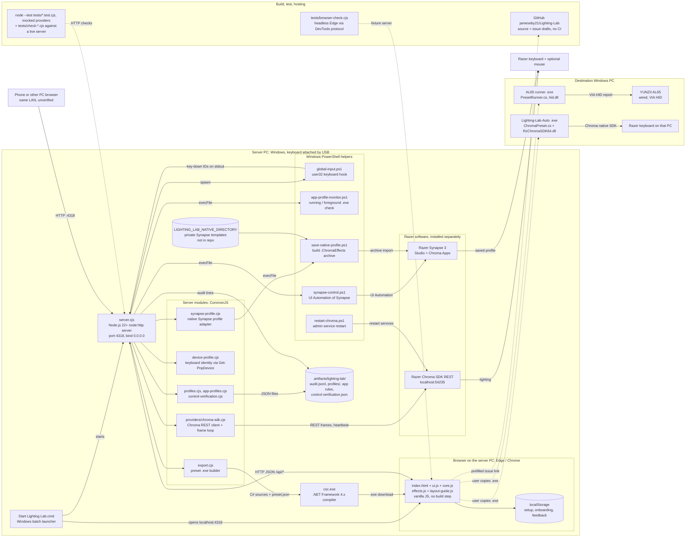
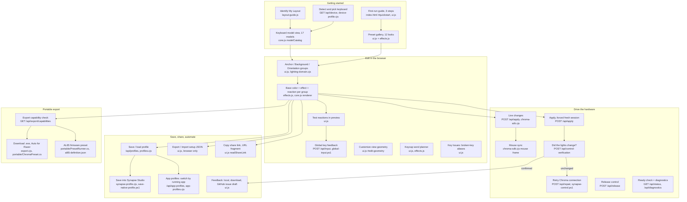

# Lighting Lab architecture

Snapshot of `main` at commit `eff3706` (2026-10-19), version 0.2.0 in `package.json`. Written from the source; nothing here is planned work unless it says "planned". Each Mermaid block below also has a `.mmd` source and an `.svg` render in [`architecture/`](architecture/): `infrastructure`, `functionality`.

## Summary

Lighting Lab is a local keyboard lighting editor for Windows. You start a small Node.js server on the PC that has the keyboard attached, open `http://localhost:4318` in a browser, pick a preset, and paint three key groups (Anchor, Background, Orientation). Each group gets a base color, a moving effect and a key-press reaction. The same JavaScript renderer draws the browser preview and the frames sent to the keyboard. On Razer hardware the server streams those frames to the Razer Chroma SDK REST service, and can also save named profiles, write a native profile into Razer Synapse Studio by driving its window, and switch profiles when a chosen app is running. The page can export a setup JSON, a share link, or a small Windows `.exe` that plays the preset on another PC: an "Auto" player for Razer keyboards, or a whole-board firmware preset for a wired YUNZII AL65. Nothing is uploaded; feedback stays in the browser unless the user downloads it or opens a prefilled GitHub issue. There is no CI, no installer and no cloud service. Per-device routing when several keyboards are attached, sensor-driven effects, and power-cycle persistence are open questions in `docs/STANDALONE-HANDOFF.md`, not built features.

## Infrastructure

Every runtime piece and where it runs. Solid arrows are data or control flow; dotted arrows are user hand-offs or test traffic.

Notes:

- The server writes all local state under `.artifacts/lighting-lab/` (ignored by Git). Override with `LIGHTING_LAB_STATE`.
- Live effects need the server to keep running. Closing it releases the keyboard back to Synapse.
- A browser on another PC controls the keyboard attached to the server PC, not its own.

## Functionality

Features and the code that implements them. Arrows show the usual order a user moves through.

HTTP routes (all in `server.cjs`): `/api/status`, `/api/device`, `/api/diagnostics`, `/api/apply`, `/api/release`, `/api/repair`, `/api/key-press`, `/api/input`, `/api/control-verification`, `/api/profiles` (+ `/:id`, `/:id/load`, `/:id/archive`), `/api/app-profiles` (+ `/config`, `/refresh`, `/:id/toggle|delete|move|test`), `/api/export/capabilities`, `/api/export/executable`. Static files are served from a fixed allowlist (`index.html`, `ui.js`, `core.js`, `effects.js`, `layout-guide.js`, `styles.css`).

## Tech stack

| Layer | Technology and version | Where it's configured |
| --- | --- | --- |
| Runtime | Node.js 22 or newer; no npm dependencies, no lockfile | `package.json` (`engines.node: ">=22"`) |
| Web server | Node `node:http`, port 4318, bind `0.0.0.0`; env `LIGHTING_LAB_PORT`, `LIGHTING_LAB_HOST`, `LIGHTING_LAB_STATE`, `LIGHTING_LAB_NATIVE_DIRECTORY` | `server.cjs` |
| Browser UI | Plain HTML, CSS and JavaScript, no framework or bundler | `index.html`, `styles.css`, `ui.js`, `core.js`, `effects.js`, `layout-guide.js` |
| Shared renderer | `core.js` (key geometry, 17-model catalog), `effects.js`, `lighting-domain.cjs` | same files |
| Live lighting | Razer Chroma SDK REST API at `http://localhost:54235/razer/chromasdk`, registered as "Jeby Lighting Lab" | `providers/chroma-sdk.cjs` |
| Native profiles | Razer Synapse 3 at its default install path; `.ChromaEffects` archives built from private local templates | `synapse-control.ps1`, `save-native-profile.ps1`, `synapse-profile.cjs`, `docs/native/README.md` |
| Windows helpers | Windows PowerShell (`powershell.exe -ExecutionPolicy Bypass`) with inline C# via `Add-Type` (user32 hook, UI Automation) | `global-input.ps1`, `app-profile-monitor.ps1`, `synapse-control.ps1`, `restart-chroma.ps1`, `device-profile.cjs` |
| Device detection | `Get-PnpDevice -PresentOnly -Class Keyboard` | `device-profile.cjs` |
| Executable export | .NET Framework 4.x `csc.exe` (`v4.0.30319`), references `System.Web.Extensions.dll` | `export.cjs` |
| Portable players | C#: `RzChromaSDK64.dll` (Razer), `hid.dll` + `setupapi.dll` (AL65 VIA HID, definition `AL65_QMK_V0101_20241025`, VID 4D4B / PID 3068) | `portable/ChromaPreset.cs`, `portable/PresetRunner.cs`, `portable/PhysicalInput.cs`, `portable/al65-definition.json` |
| Diagnostics tool | C# native Chroma diagnostic, built by a test script | `tools/NativeChromaDiagnostic.cs`, `tests/build-native-diagnostic.cjs` |
| Tests | `node:test` (8 test files); headless Edge or Chromium via the DevTools protocol (`LIGHTING_LAB_BROWSER`) | `package.json` scripts, `tests/` |
| Launcher | Windows batch file that checks for Node and opens the browser | `Start Lighting Lab.cmd` |
| CI | None | none |
| Hosting | Public GitHub repo `jameseby21/Lighting-Lab`; the app itself runs only on the user's PC | `.git/config` |
| License | See `LICENSE` | `LICENSE` |

## Brand assets in this repo

No image, logo, icon or favicon files are tracked. The brand is drawn in markup and CSS:

| Asset | Path | Format | Light / dark | Where displayed |
| --- | --- | --- | --- | --- |
| "ll•" mark | `index.html` (`span.mark` in the header), styled by `.mark` in `styles.css` | HTML text + CSS (purple tile, green dot) | Dark only (`color-scheme: dark`) | Top-left of the page header |
| Wordmark "Lighting Lab / by jeby Labs" | `index.html` header and footer | HTML text | Dark only | Header and footer |
| Page title "Lighting Lab · jeby Labs" | `index.html` `<title>` | Text | n/a | Browser tab |
| Theme color `#101219` | `index.html` `<meta name="theme-color">` | Meta tag | Dark | Mobile browser chrome |
| Vendor app name "Jeby Lighting Lab", author "jeby Labs" | `providers/chroma-sdk.cjs` (`APP_TITLE`) | String sent to the Chroma SDK | n/a | Synapse's Chroma Apps list |

There is no favicon: the page has no `<link rel="icon">` and the server's static allowlist has no `/favicon.ico`, so browsers get a 404 and show a default icon. Exported `.exe` files are compiled without `/win32icon`, so they carry the default Windows program icon. Nothing rotates between variants.

## Where this file should live

Recommended path: `docs/ARCHITECTURE.md`. The repo already keeps long-form docs in `docs/` with upper-case names (`DESIGN.md`, `RESEARCH-EXPORT.md`, `STANDALONE-HANDOFF.md`, `VALIDATION.md`).

Registration: add one link to it from `README.md` (for example under "Development chunks" or a short "Documentation" line). The repo has no AGENTS.md, CLAUDE.md, doc-link checker or CI, and no test reads `docs/`, so nothing else needs updating to keep checks green. The `.mmd` sources and `.svg` renders sit next to it in `docs/architecture/`; they are optional because GitHub renders the Mermaid blocks.

## Unclear

- unclear: `README.md` "Checks" lists `uv run ruff check .`, `uv run mypy src` and `uv run pytest`, but the repo has no Python code, `pyproject.toml` or `src/`. These look carried over from the parent repo.
- unclear: `restart-chroma.ps1` writes its log to `../../.artifacts/lighting-lab` relative to the script, which is two folders above this repo's root (a path from the earlier monorepo layout).
- unclear: `README.md` calls `docs/background/keyboard-layout/` "ignored", but `.gitignore` in this repo does not list it.
- unclear: the README's validation list numbers two steps "6"; the second one repeats the AL65 export check.
